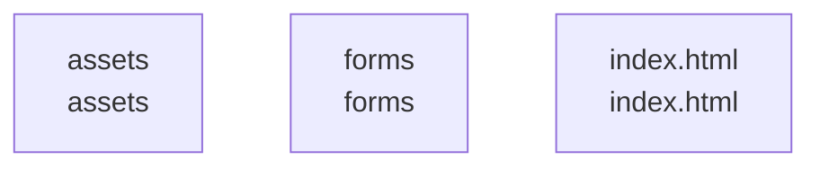

# overall-architecture

[解析トップへ戻る](../README.md)

# arsha_site

Arshaテンプレートを使う静的サイト。HTML、CSS、ブラウザー用JavaScriptで構成されます。

この図はリポジトリ内の構成です。コードを実行した結果やサービス間の通信保証ではありません。

## 対象と根拠

対象: https://github.com/FORIFOR/arsha_site

取得ブランチ: `main`

Git tree SHA: `86c0c8250044596cafccd98547754a0fc3d5ab1c`

ファイル一覧: 117件。内容確認: 2件。全ファイルの意味解析ではありません。

## 解析の制約

実コードの取得は入口、マニフェスト、直接参照先を中心とする初回解析です。動的ロード、実行時設定、別リポジトリとの接続、ローカル未コミット変更は未確認です。

## 確認が必要な点

構成図の配置関係と、実際の通信・呼び出し関係を区別してください。README上の機能や精度の記述は動作検証済みという意味ではありません。

## 追加解析

未読の中核モジュールから処理順序・データ保存・状態遷移を追加解析する。実行環境で通信先と機能フラグを照合する。

## 補足

2026-10-11の初回解析スナップショットです。現在のコードとの差分や実行環境は追加確認が必要です。

## 要素の説明

### n-assets-3685e3

確認したパス: `assets`。配下の登録ファイルは109件。

- `assets/css/main.css`（一覧のみ）
- `assets/img/apple-touch-icon.png`（一覧のみ）
- `assets/img/clients/client-1.png`（一覧のみ）
- `assets/img/clients/client-2.png`（一覧のみ）
- `assets/img/clients/client-3.png`（一覧のみ）
- `assets/img/clients/client-4.png`（一覧のみ）
- `assets/img/clients/client-5.png`（一覧のみ）
- `assets/img/clients/client-6.png`（一覧のみ）
- `assets/img/clients/client-7.png`（一覧のみ）
- `assets/img/clients/client-8.png`（一覧のみ）
- `assets/img/cta-bg.jpg`（一覧のみ）
- `assets/img/favicon.png`（一覧のみ）
- `assets/img/hero-img.png`（一覧のみ）
- `assets/img/logo.png`（一覧のみ）
- `assets/img/masonry-portfolio/masonry-portfolio-1.jpg`（一覧のみ）
- `assets/img/masonry-portfolio/masonry-portfolio-2.jpg`（一覧のみ）
- `assets/img/masonry-portfolio/masonry-portfolio-3.jpg`（一覧のみ）
- `assets/img/masonry-portfolio/masonry-portfolio-4.jpg`（一覧のみ）
- `assets/img/masonry-portfolio/masonry-portfolio-5.jpg`（一覧のみ）
- `assets/img/masonry-portfolio/masonry-portfolio-6.jpg`（一覧のみ）
- `assets/img/masonry-portfolio/masonry-portfolio-7.jpg`（一覧のみ）
- `assets/img/masonry-portfolio/masonry-portfolio-8.jpg`（一覧のみ）
- `assets/img/masonry-portfolio/masonry-portfolio-9.jpg`（一覧のみ）
- `assets/img/portfolio/app-1.jpg`（一覧のみ）
- `assets/img/portfolio/books-1.jpg`（一覧のみ）
- `assets/img/portfolio/branding-1.jpg`（一覧のみ）
- `assets/img/portfolio/product-1.jpg`（一覧のみ）
- `assets/img/services.jpg`（一覧のみ）
- `assets/img/skills.png`（一覧のみ）
- `assets/img/team/team-1.jpg`（一覧のみ）
- `assets/img/team/team-2.jpg`（一覧のみ）
- `assets/img/team/team-3.jpg`（一覧のみ）
- `assets/img/team/team-4.jpg`（一覧のみ）
- `assets/img/testimonials/testimonials-1.jpg`（一覧のみ）
- `assets/img/testimonials/testimonials-2.jpg`（一覧のみ）

[詳細な図と説明を見る](n-assets-3685e3/README.md)

### n-forms-453ca9

確認したパス: `forms`。配下の登録ファイルは3件。

- `forms/Readme.txt`（一覧のみ）
- `forms/contact.php`（一覧のみ）
- `forms/newsletter.php`（一覧のみ）

### n-index-html-f6013a

確認したパス: `index.html`。配下の登録ファイルは1件。

- `index.html`（一覧のみ）

