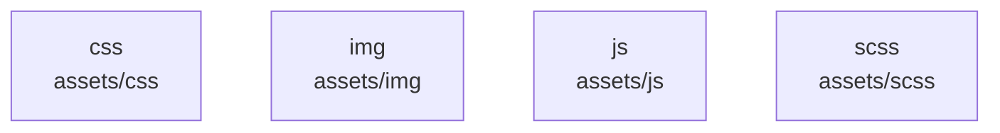

# overall-architecture/n-assets-3685e3

[解析トップへ戻る](../../README.md)

確認したパス: `assets`。配下の登録ファイルは109件。

- `assets/css/main.css`（一覧のみ）
- `assets/img/apple-touch-icon.png`（一覧のみ）
- `assets/img/clients/client-1.png`（一覧のみ）
- `assets/img/clients/client-2.png`（一覧のみ）
- `assets/img/clients/client-3.png`（一覧のみ）
- `assets/img/clients/client-4.png`（一覧のみ）
- `assets/img/clients/client-5.png`（一覧のみ）
- `assets/img/clients/client-6.png`（一覧のみ）
- `assets/img/clients/client-7.png`（一覧のみ）
- `assets/img/clients/client-8.png`（一覧のみ）
- `assets/img/cta-bg.jpg`（一覧のみ）
- `assets/img/favicon.png`（一覧のみ）
- `assets/img/hero-img.png`（一覧のみ）
- `assets/img/logo.png`（一覧のみ）
- `assets/img/masonry-portfolio/masonry-portfolio-1.jpg`（一覧のみ）
- `assets/img/masonry-portfolio/masonry-portfolio-2.jpg`（一覧のみ）
- `assets/img/masonry-portfolio/masonry-portfolio-3.jpg`（一覧のみ）
- `assets/img/masonry-portfolio/masonry-portfolio-4.jpg`（一覧のみ）
- `assets/img/masonry-portfolio/masonry-portfolio-5.jpg`（一覧のみ）
- `assets/img/masonry-portfolio/masonry-portfolio-6.jpg`（一覧のみ）
- `assets/img/masonry-portfolio/masonry-portfolio-7.jpg`（一覧のみ）
- `assets/img/masonry-portfolio/masonry-portfolio-8.jpg`（一覧のみ）
- `assets/img/masonry-portfolio/masonry-portfolio-9.jpg`（一覧のみ）
- `assets/img/portfolio/app-1.jpg`（一覧のみ）
- `assets/img/portfolio/books-1.jpg`（一覧のみ）
- `assets/img/portfolio/branding-1.jpg`（一覧のみ）
- `assets/img/portfolio/product-1.jpg`（一覧のみ）
- `assets/img/services.jpg`（一覧のみ）
- `assets/img/skills.png`（一覧のみ）
- `assets/img/team/team-1.jpg`（一覧のみ）
- `assets/img/team/team-2.jpg`（一覧のみ）
- `assets/img/team/team-3.jpg`（一覧のみ）
- `assets/img/team/team-4.jpg`（一覧のみ）
- `assets/img/testimonials/testimonials-1.jpg`（一覧のみ）
- `assets/img/testimonials/testimonials-2.jpg`（一覧のみ）

## 要素の説明

### n-assets-css-3c2ec2

実在パス: `assets/css`。1ファイル。

- `assets/css/main.css`

### n-assets-img-e64d6e

実在パス: `assets/img`。38ファイル。

- `assets/img/apple-touch-icon.png`
- `assets/img/clients/client-1.png`
- `assets/img/clients/client-2.png`
- `assets/img/clients/client-3.png`
- `assets/img/clients/client-4.png`
- `assets/img/clients/client-5.png`
- `assets/img/clients/client-6.png`
- `assets/img/clients/client-7.png`
- `assets/img/clients/client-8.png`
- `assets/img/cta-bg.jpg`
- `assets/img/favicon.png`
- `assets/img/hero-img.png`
- `assets/img/logo.png`
- `assets/img/masonry-portfolio/masonry-portfolio-1.jpg`
- `assets/img/masonry-portfolio/masonry-portfolio-2.jpg`
- `assets/img/masonry-portfolio/masonry-portfolio-3.jpg`
- `assets/img/masonry-portfolio/masonry-portfolio-4.jpg`
- `assets/img/masonry-portfolio/masonry-portfolio-5.jpg`
- `assets/img/masonry-portfolio/masonry-portfolio-6.jpg`
- `assets/img/masonry-portfolio/masonry-portfolio-7.jpg`
- `assets/img/masonry-portfolio/masonry-portfolio-8.jpg`
- `assets/img/masonry-portfolio/masonry-portfolio-9.jpg`
- `assets/img/portfolio/app-1.jpg`
- `assets/img/portfolio/books-1.jpg`
- `assets/img/portfolio/branding-1.jpg`

### n-assets-js-2f9872

実在パス: `assets/js`。1ファイル。

- `assets/js/main.js`

### n-assets-scss-5267fc

実在パス: `assets/scss`。1ファイル。

- `assets/scss/Readme.txt`

